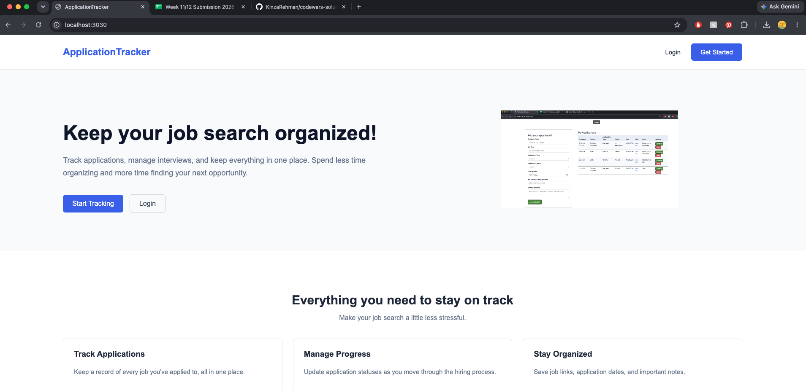

# Application Tracker

Application Tracker is a full-stack web application that helps users organize and manage their job search. Users can save job applications, track their progress, and keep important application details in one place.

### Live Link
[Application Tracker]("")

### Image

### Current Progress
- Users can create an account, log in, and log out.
- User authentication is handled using Passport.js.
- Users can add job applications with company name, position, application date, and status.
- Users can save job links and notes.
- Users can view their saved applications on their profile page.
- Users can edit and delete applications.
- Application data is stored in MongoDB and associated with individual users.

### Tools
- **HTML & CSS** – Front-end structure and styling
- **JavaScript** – Application functionality
- **Node.js** – Server-side JavaScript
- **Express.js** – Routing and server management
- **EJS** – Dynamic HTML templates
- **MongoDB** – Database for users and job applications
- **Mongoose** – Database models and queries
- **Passport.js** – User authentication
- **bcrypt** – Password hashing
- **express-session** – User sessions

### Future Improvements
- Add filtering by application status.
- Add a search feature to find applications by company or position.
- Build a dashboard showing total applications, interviews, offers, and rejections.
- Improve the user interface and mobile responsiveness.
- Create a dashbaord with important and key KPIs
