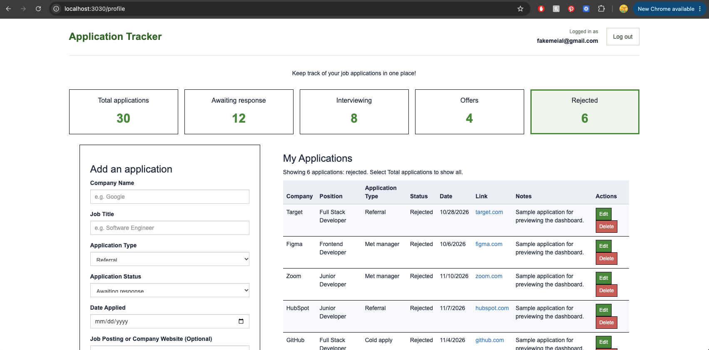

# Application Tracker

Application Tracker is a full-stack web application that helps users organize and manage their job search. Users can save job applications, track their progress, and keep important application details in one place.

### Live Link
[Application Tracker](https://applicationtracker-6x2d.onrender.com/)

### Image



### Current Progress
- Users can create an account, log in, and log out.
- User authentication is handled using Passport.js.
- Users can add job applications with company name, position, application date, and status.
- Users can save job links and notes.
- Users can view their saved applications on their profile page.
- Users can edit and delete applications.
- Application data is stored in MongoDB and associated with individual users.

### Tools
- **HTML & CSS** – Front-end structure and styling
- **JavaScript** – Application functionality
- **Node.js** – Server-side JavaScript
- **Express.js** – Routing and server management
- **EJS** – Dynamic HTML templates
- **MongoDB** – Database for users and job applications
- **Mongoose** – Database models and queries
- **Passport.js** – User authentication
- **bcrypt** – Password hashing
- **express-session** – User sessions


### Run Locally

You will need Git, Node.js and npm, and a MongoDB database (local or MongoDB Atlas).

1. Clone the repository and install dependencies:

   ```bash
   git clone https://github.com/KinzaRehman/ApplicationTracker.git
   cd ApplicationTracker
   npm install
   ```

2. Create a `.env` file in the project root, next to `package.json`:

   ```dotenv
   MONGO_URI=mongodb://127.0.0.1:27017/applicationtracker
   SESSION_SECRET=replace-with-a-long-random-string
   PORT=3030
   ```

   Start your local MongoDB server before running the app. If using MongoDB Atlas, replace `MONGO_URI` with your connection string, including your database name and database user credentials, and allow your IP address in Atlas. Set your own random `SESSION_SECRET` and keep `.env` private.

3. Start the development server:

   ```bash
   npm run dev
   ```

   Nodemon automatically restarts the server when server files change. To run without automatic restarts, use `npm start`.

4. Open [http://localhost:3030](http://localhost:3030) and create an account. If you change `PORT`, use that port in the browser address.

Press `Ctrl+C` in the terminal to stop the server.

### Future Improvements
- Add filtering by application status.
- Add a search feature to find applications by company or position.
- Build a dashboard showing total applications, interviews, offers, and rejections.
- Improve the user interface and mobile responsiveness.
- Create a dashbaord with important and key KPIs
